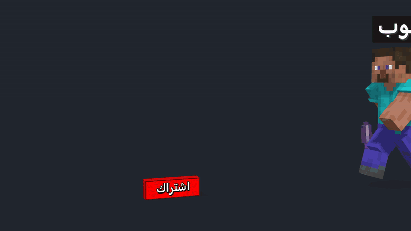
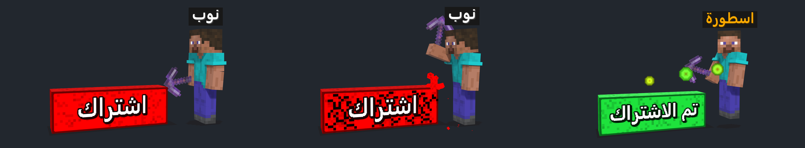
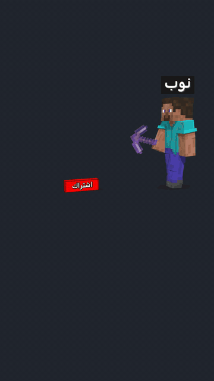

# Steve Subscribe Animation

**An Arabic Minecraft subscribe animation, built entirely in code.**
Steve mines the red **اشتراك** block until it breaks, and goes from **نوب** (noob) to **اسطورة** (legend).

[Watch the long version](videos/steve_subscribe_long.mp4) · [Watch the Shorts version](videos/steve_subscribe_shorts.mp4)

## The story in three shots

*Noob, cracking, legend.*

## Also in vertical

*The same scene as a 9:16 Short.*

## Highlights

- **Two formats from one scene:** 16:9 for YouTube and 9:16 for Shorts, switched with a single option.
- **1080p, 60 fps** with the real Minecraft hit, break and step sounds, timed to each frame.
- **Correct Arabic:** letters join and read right to left, before and after the break (**اشتراك** → **تم الاشتراك**).
- **Easy to key out:** flat pink background (`#FF00B3`), plus see-through PNG frames for a transparent version.
- **Fully scripted:** the pose, camera, timing and sound are code, so every change is repeatable.

## How it works

1. **Assets:** Python draws the bar faces and name tags with correct Arabic shaping.
2. **Scene:** one Blender script builds Steve, the pickaxe, the block, the cracks, the break and the camera, and writes a timeline of events.
3. **Video:** FFmpeg turns the frames into a video, and the sounds are mixed in at the exact frames from that timeline.

## Built with

Blender 5.2 (Python API) · Python (Pillow, arabic-reshaper, python-bidi) · FFmpeg

## Make it yourself

You need Blender 5.2, FFmpeg, Windows (for the Segoe UI Bold font), and Minecraft Java 1.21.1 launched once, so the game files exist on your PC. Run these from the `steve/` folder.

1. Copy the game textures from your own install: `python fetch_assets.py`
2. Copy the game sounds from your own install: `python get_sounds.py`
3. Draw the bar faces and name tags: `python make_assets.py`
4. Render the frames: `blender -b -P steve_scene.py -- <frames_dir> res=1920 samples=64 step=1 ver=long`
   Use `ver=shorts` for the vertical version.
5. Add the sound and make the video: `python make_video.py <frames_dir> <out.mp4> 60`

Install the Python parts with `pip install pillow arabic-reshaper python-bidi`.

## Project layout

| Path | What it does |
|---|---|
| `steve/steve_scene.py` | The Blender scene and the whole timeline |
| `steve/make_assets.py` | The bar faces and name tags |
| `steve/make_video.py` | Puts the frames on pink and mixes the sounds |
| `steve/fetch_assets.py`, `steve/get_sounds.py` | Copy the game textures and sounds from your own Minecraft install |
| `steve/rig` | The Steve rig code |
| `videos/` | The final renders and previews |

## License and credits

The code is MIT licensed (see [LICENSE](LICENSE)). Minecraft textures, sounds and names belong to Mojang Studios and Microsoft and are not stored in this repository.

**NOT AN OFFICIAL MINECRAFT PRODUCT. NOT APPROVED BY OR ASSOCIATED WITH MOJANG OR MICROSOFT.**
